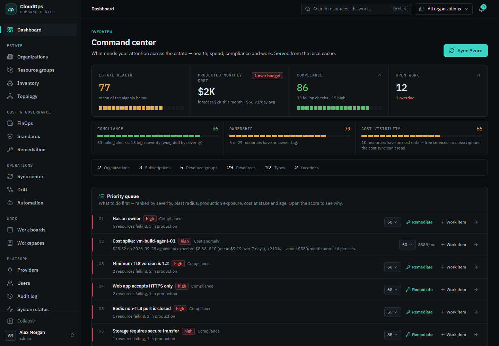
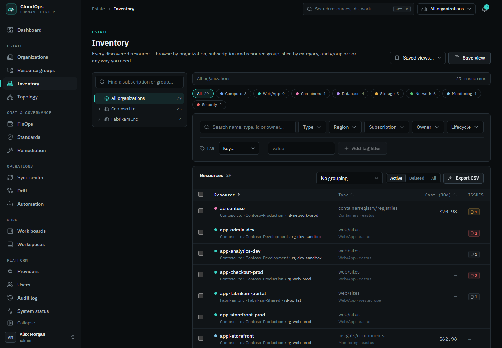
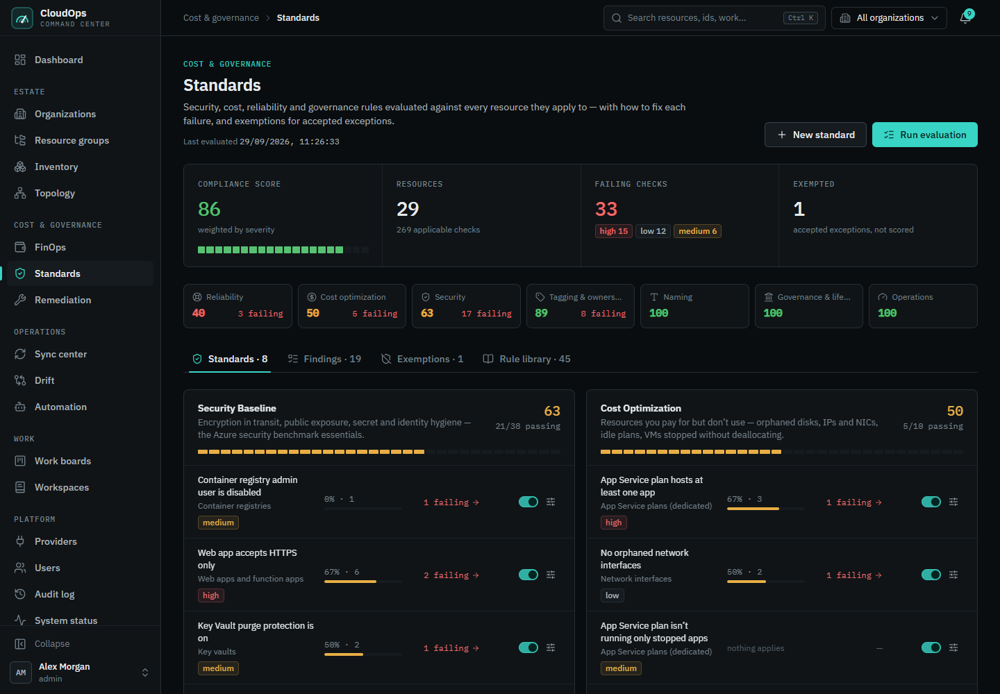
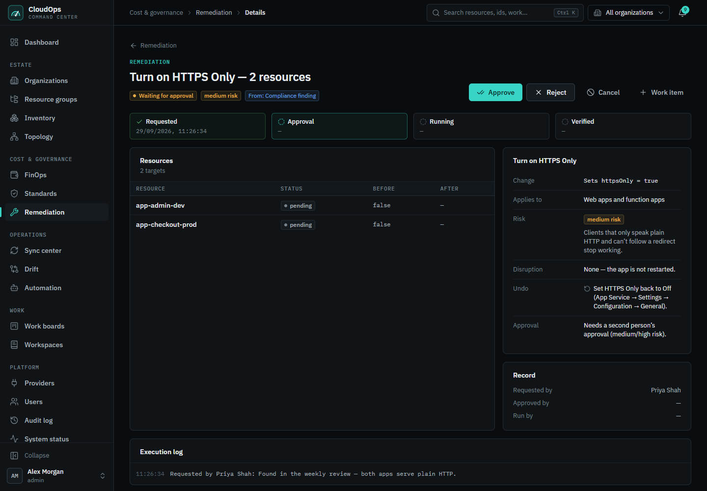
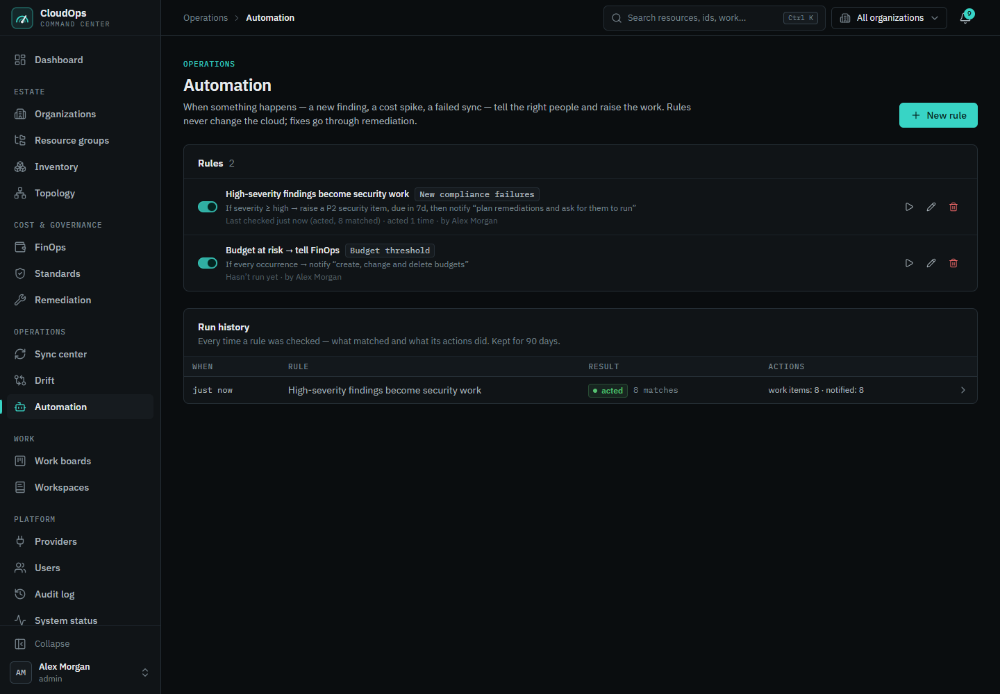
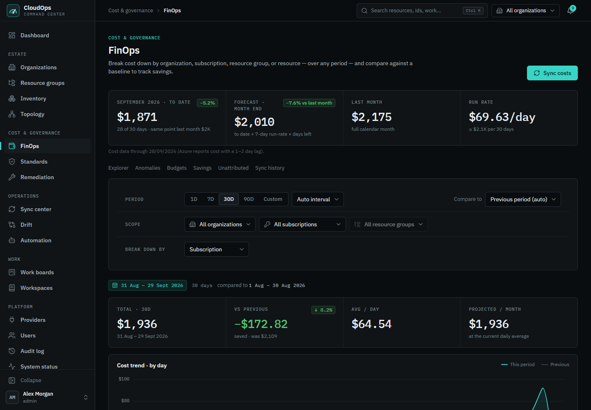
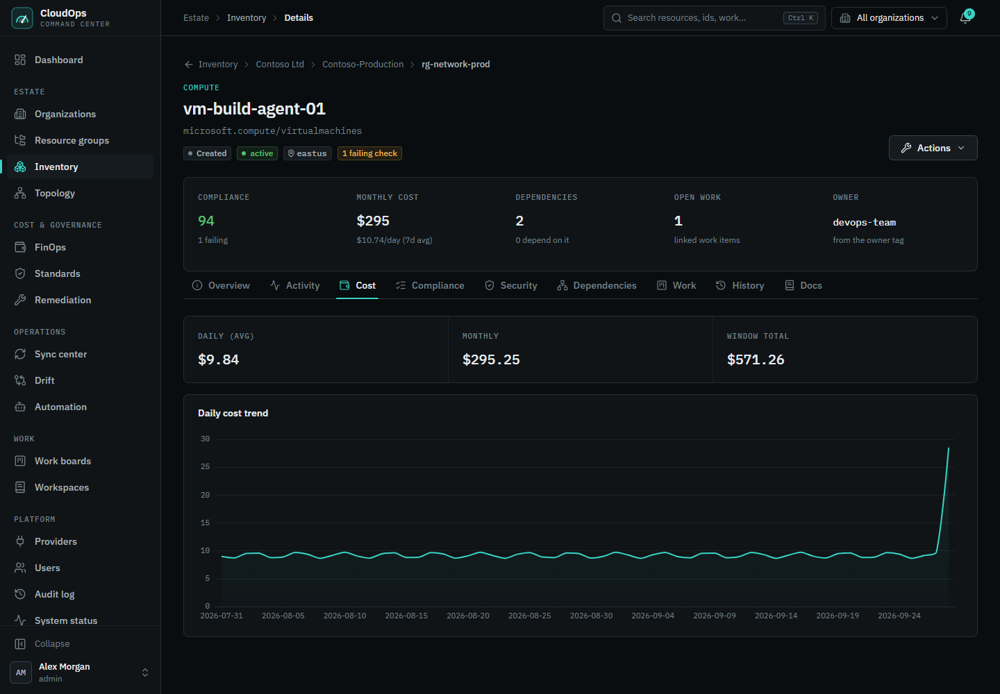
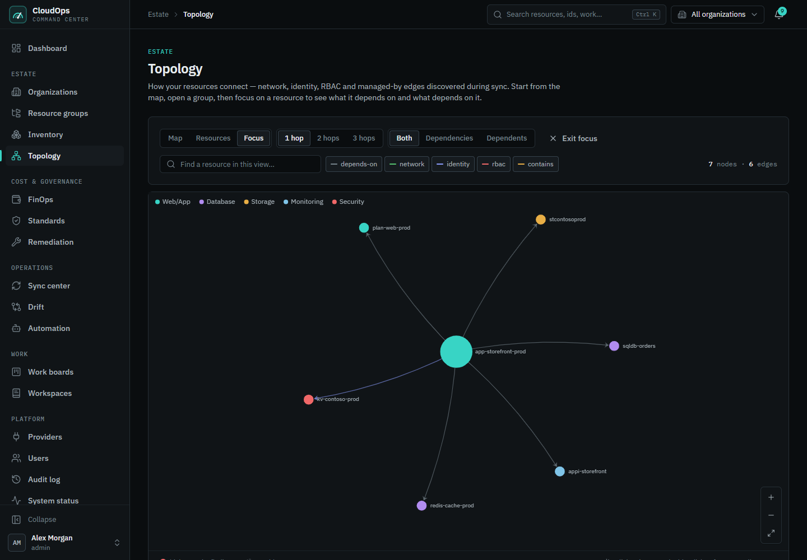
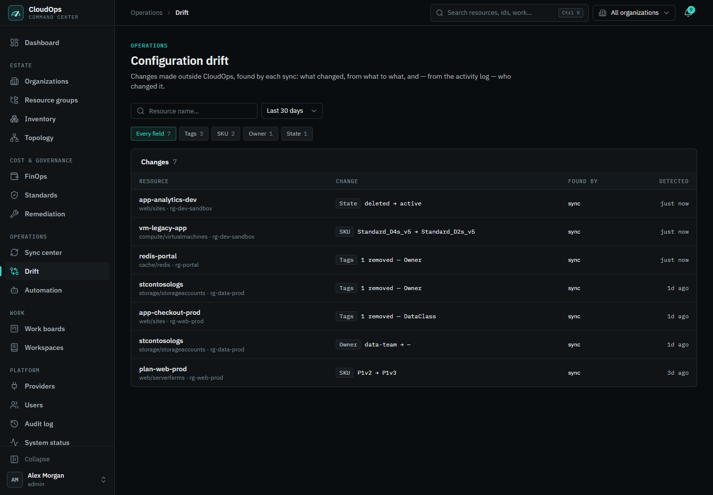
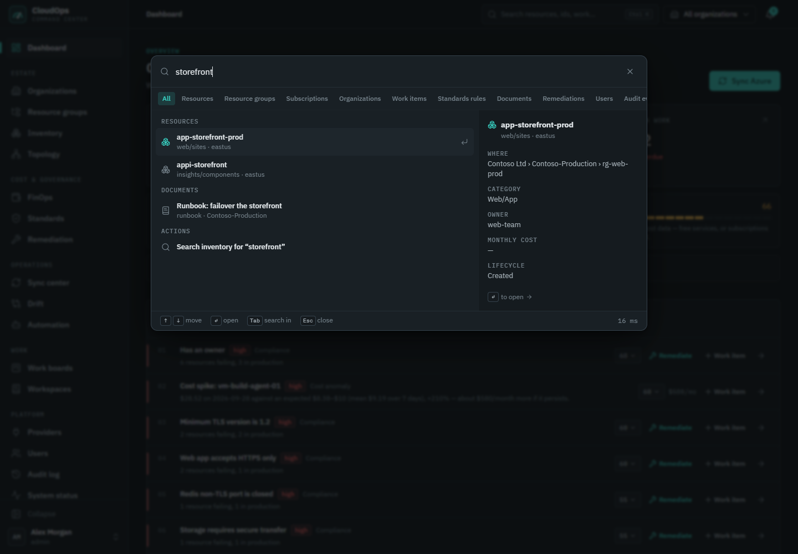

# CloudOps — a self-hosted command center for your cloud

CloudOps turns an Azure estate into one place where you can **see** everything, **decide** what
matters, **fix** it safely, and **prove** what was done. It runs on your own laptop or server
with Docker Compose, depends on no third-party SaaS, and treats cloud providers as plugins
(Azure first).



> Screenshots use a fictional demo estate ("Contoso" and "Fabrikam"). No real customer data.

<details open>
<summary><h2 style="display:inline-block">Why it exists</h2></summary>

Cloud consoles show you *what exists*. They rarely tell you *what to do next*, and fixing
something usually means leaving the tool, clicking through the portal, and hoping someone writes
it down. CloudOps closes that loop:

**Discover → understand → prioritize → investigate → fix → automate → verify → audit**

</details>

<details open>
<summary><h2 style="display:inline-block">What you can do</h2></summary>

| | |
| --- | --- |
| **See the whole estate** | Every organization, subscription, resource group and resource in one inventory: filter, group, search and export. Resources that vanish from Azure are flagged, not silently kept. |
| **Know what to fix first** | A priority queue ranks findings, cost spikes, budgets, failed syncs and overdue work. Every score lists its reasons (severity, production impact, money at stake, days overdue), with no black-box "AI score". |
| **Stay compliant** | 45 built-in rules across security, cost, reliability, tagging, naming and operations. Each explains why it matters and how to fix it. Add custom rules, grant exemptions with reasons and expiry, and track scores by category. |
| **Control cost** | Daily cost per resource, month-to-date and forecast, budgets, savings opportunities, and anomaly detection that says *why* a cost is unusual and what it would cost per month. |
| **Fix problems safely** | Remediation plans show the exact change and the exact command *before* anything happens. Risky changes need a second person's approval. Changes run in the background and are verified by reading the resource back. |
| **Automate the routine** | Rules like *"when a new high-severity finding appears, create a security task and notify the security team"*. You can preview a rule against today's data before turning it on. Rules raise work and alerts; they never change the cloud on their own. |
| **Catch drift** | See what changed outside the tool (tags, owner, SKU, location), look up who changed it in the activity log, and restore previous tags in a click. |
| **Understand dependencies** | A topology map of how resources connect; focus on one resource to see what it depends on and what depends on it. |
| **Work as a team** | Work items with owners, due dates, @mentions and a full activity trail; markdown runbooks with templates and version history; notifications for anything that needs attention. |
| **Operate it with confidence** | Roles and fine-grained permissions, session management, a searchable and exportable audit log, background job monitoring with retry, and a Prometheus `/metrics` endpoint. |

</details>

<details open>
<summary><h2 style="display:inline-block">A quick tour</h2></summary>

| | |
| --- | --- |
|  **Inventory**: every resource, where it lives, what it costs, what's failing. |  **Standards**: scores by category, failing checks and how to fix them. |
|  **Remediation**: preview, approve, run, verify, with the risk and the undo spelled out. |  **Automation**: when → if → then rules, with a full run history. |
|  **FinOps**: month to date, forecast, budgets and anomalies. |  **Resource detail**: cost trend, compliance, dependencies, work and history. |
|  **Topology**: focus on one resource and follow its dependencies. |  **Drift**: changes made outside the tool, and by whom. |

Press **Ctrl/⌘ + K** anywhere to search resources, tags (`env=prod`), IPs, work items and docs:



</details>

<details open>
<summary><h2 style="display:inline-block">How it works</h2></summary>

```
Browser (React)  ──►  API (Node.js / Express)  ──►  PostgreSQL  (your estate, cost, findings, history)
                           │
                           ├──►  Background jobs (BullMQ on Redis): sync · cost · evaluation · remediation
                           │
                           └──►  Azure (az CLI): read everything; write only approved changes
```

1. **Sync** reads your Azure organizations into PostgreSQL: resources, relationships, tags and
   daily cost. Every page then reads that local copy, so the UI is fast and works even when Azure
   is slow.
2. After each sync, **compliance rules** are evaluated in the background and **anomalies** are
   computed from the cost history.
3. You act from the dashboard: create a **work item**, or start a **remediation** (plan → approve →
   run → verify).
4. **Notifications** and **automation rules** react to what happened, and the **audit log** records
   every change.

</details>

<details open>
<summary><h2 style="display:inline-block">Safe by design</h2></summary>

- **Nothing changes without a preview.** Every remediation shows current → new values and the
  exact provider command first.
- **Four-eyes approval** for medium- and high-risk changes (configurable for single-admin installs).
- **Writes are opt-in.** A single switch (`AZURE_ALLOW_WRITE`) makes the platform strictly
  read-only, and the Azure executor independently refuses write commands unless a call is allowed
  to write.
- **No destructive surprises.** The only deletions offered are unattached public IPs, orphaned
  network interfaces and empty App Service plans; disks and databases are never deletable.
- **Secrets never touch the database.** Cloud credentials live in an AES-256-GCM encrypted local
  store and are never returned by the API. Each organization runs in its own isolated CLI profile.
- **Accounts are admin-managed** with five roles built from 20 named permissions, short-lived
  tokens, "sign out everywhere", rate limiting and a full audit trail.

</details>

<details open>
<summary><h2 style="display:inline-block">Quick start</h2></summary>

Prerequisites: Docker Desktop (Compose v2).

```bash
cp .env.example .env          # the defaults work for a local trial
docker compose up -d --build
```

On first start the API applies its database migrations and creates the first admin. Then:

- **Web UI:** http://localhost:5173. Sign in with `SEED_ADMIN_EMAIL` / `SEED_ADMIN_PASSWORD` from
  `.env`; you will be asked to choose your own password.
- **API docs (Swagger):** http://localhost:3000/api/docs
- **Health check:** http://localhost:3000/health/ready

Connect Azure: **Providers → Add organization**, enter a service principal (tenant ID, client ID,
secret) with **Reader** and **Cost Management Reader** on your subscriptions, test it, save, then
open **Sync center → Sync inventory** and **Sync cost**. Writing tags needs **Tag Contributor**,
and applying fixes needs **Contributor** on the resources you want CloudOps to change.

Running on Windows and want to reuse your own `az login` instead of a service principal? See
[host mode](docs/GUIDE.md#2b-host-mode).

Before exposing it to anyone else, work through the
[production checklist](docs/GUIDE.md#production-checklist).

</details>

<details open>
<summary><h2 style="display:inline-block">Tech stack</h2></summary>

| Layer | Technology |
| --- | --- |
| Web | React 18, TypeScript, Vite, Tailwind CSS, TanStack Query and Table, ECharts |
| API | Node.js, Express, TypeScript, Prisma, Zod, OpenAPI |
| Data | PostgreSQL 16 (with trigram search), Redis 7 + BullMQ for background jobs |
| Cloud | Azure Resource Graph, Cost Management, Activity Log, via a hardened `az` CLI executor |
| Delivery | Docker Compose, nginx, GitHub Actions CI, Vitest unit and integration tests |

```
apps/
  api/   Modular monolith: routes → services → repositories, workers, migrations
  web/   Single-page app
packages/
  core/            Shared types and validation (used by both api and web)
  kernel/          Dependency injection, event bus, lifecycle, plugins
  credentials/     Encrypted credential store
  provider-sdk/    The contract every cloud provider implements
  provider-azure/  The Azure provider
```

</details>

<details open>
<summary><h2 style="display:inline-block">Development</h2></summary>

Requires Node 20+ and pnpm 9.

```bash
pnpm install
docker compose up -d postgres redis
cp apps/api/.env.example apps/api/.env      # host-side settings (localhost URLs)
pnpm --filter @cloudops/api db:migrate      # versioned migrations (safe to re-run)
pnpm --filter @cloudops/api prisma:seed     # roles + first admin
pnpm dev                                    # api on :3000 (with workers), web on :5173
```

| Command | What it does |
| --- | --- |
| `pnpm typecheck` | Type-check the whole workspace |
| `pnpm lint` | ESLint across every package |
| `pnpm test` | Unit tests (no external services needed) |
| `pnpm --filter @cloudops/api test:integration` | API integration tests; set `INTEGRATION_DATABASE_URL` and `INTEGRATION_REDIS_URL` to a **disposable** Postgres and Redis |
| `pnpm build` | Compile the API and build the web bundle |

</details>

<details open>
<summary><h2 style="display:inline-block">Documentation</h2></summary>

The [CloudOps guide](docs/GUIDE.md) covers:

- [Architecture](docs/GUIDE.md#architecture): modules, request pipeline, security model, background jobs, remediation and automation
- [Configuration](docs/GUIDE.md#configuration): every environment variable
- [Deployment](docs/GUIDE.md#deployment): install, upgrade, production checklist, [backup & restore](docs/GUIDE.md#backup--restore)
- [Data model](docs/GUIDE.md#data-model-erd): the database schema
- [Provider plugin guide](docs/GUIDE.md#provider-plugin-guide): adding another cloud (AWS, GCP, Kubernetes…)

</details>

<details open>
<summary><h2 style="display:inline-block">Adding another cloud</h2></summary>

Providers are plugins. Implement the `CloudProvider` contract in `packages/provider-sdk`
(discovery, cost, and optionally actions and activity), register it, and the inventory, cost,
standards, topology and remediation features work with it. See the
[provider plugin guide](docs/GUIDE.md#provider-plugin-guide).

</details>

<details open>
<summary><h2 style="display:inline-block">License</h2></summary>

[MIT](LICENSE)

</details>
